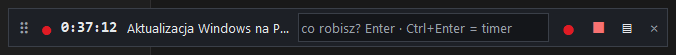
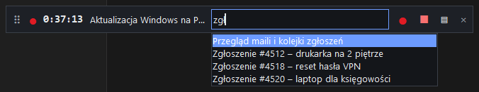
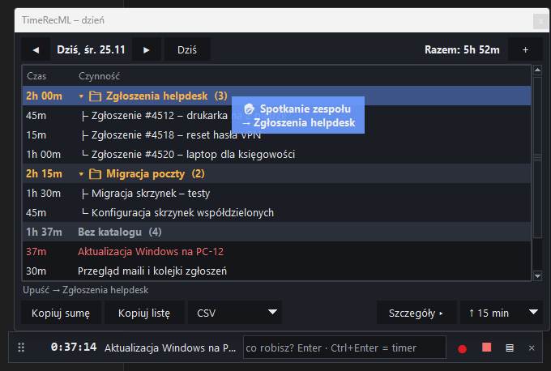
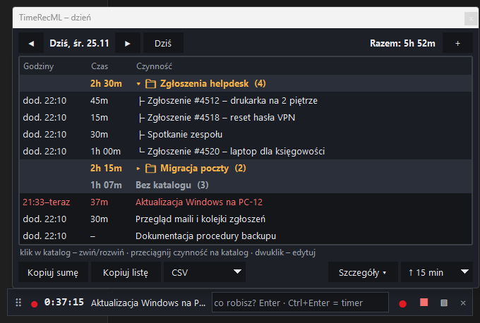

<p align="center"></p>

<h1 align="center">TimeRecML</h1>

<p align="center">Mały pasek na pulpit Windows do szybkiego rozpisywania, co robiło się w pracy.</p>

Wpisujesz czynność i wciskasz Enter. Jeśli chcesz mierzyć czas, „nagrywasz” go czerwoną kropką ● jak na kamerze.
Na koniec dnia kopiujesz gotowe podsumowanie do systemu helpdesk albo eksportujesz CSV.

- Wąski pasek, zawsze na wierzchu, bez okna i ikony na pasku zadań
- Czynności bez czasu, z czasem wpisanym ręcznie albo nagrywanym timerem (migająca kropka REC)
- Zaokrąglanie zawsze w górę (domyślnie do 15 min, do wyboru: bez / 5 / 15 / 30 min)
- Podpowiedzi z wcześniej wpisanych czynności
- Katalogi na dany dzień: grupowanie czynności przeciąganiem (drag & drop), z sumą czasu katalogu
- Kopiowanie podsumowania dnia do schowka i eksport CSV (dzień / tydzień / miesiąc)
- Globalny skrót **Ctrl+Alt+T**, który przenosi kursor do paska z dowolnego programu
- Bez internetu i bez kont. Dane leżą lokalnie w jednym pliku JSON

## Zrzuty ekranu

Pasek podczas nagrywania czasu:



Podpowiedzi przy wpisywaniu:



Lista dnia z katalogami (przeciąganie czynności do katalogu) i widok szczegółów z godzinami:




## Wymagania

- Windows 10 / 11
- [Python](https://www.python.org/downloads/) 3.8 lub nowszy, z modułem tkinter (instaluje się domyślnie)

Inne pakiety nie są potrzebne.

## Instalacja

1. Pobierz repozytorium (**Code → Download ZIP** i rozpakuj) albo:
   ```powershell
   git clone https://github.com/<twoj-login>/TimeRecML.git
   ```
2. Jeśli nie masz Pythona:
   ```powershell
   winget install Python.Python.3.12
   ```
3. W folderze aplikacji uruchom instalator:
   ```powershell
   powershell -ExecutionPolicy Bypass -File .\instaluj.ps1
   ```
   Opcje:
   | Przełącznik | Działanie |
   |---|---|
   | `-Pulpit` | dodatkowo skrót na pulpicie |
   | `-Autostart` | uruchamianie po zalogowaniu do Windows |
   | `-Odinstaluj` | usuwa skróty, dane zostają |

4. Uruchom **TimeRecML** z menu Start.

Bez instalatora wystarczy dwuklik na `TimeRecML.pyw`.

> Folder aplikacji trzymaj w miejscu, w którym masz prawo zapisu (np. `Dokumenty`, a nie `Program Files`).
> Dane zapisują się w nim jako `dane.json`.

## Obsługa

| Co | Jak |
|---|---|
| Dopisz czynność (bez czasu) | wpisz i **Enter** |
| Nagrywaj czas czynności | **Ctrl+Enter** albo czerwona **●** |
| Zatrzymaj nagrywanie | **■** |
| Czynność z gotowym czasem | `45m opis`, `1h30 opis` |
| Podpowiedzi | **↑ / ↓** w polu wpisywania |
| Lista dnia | **▤** albo kliknięcie w licznik na pasku |
| Edycja / dopisanie czasu | dwuklik na wpisie (czas: `45`, `1h30`, `1:30`) |
| Usuń wpis | **Del** |
| Więcej opcji | prawy przycisk myszy (nagrywaj, duplikuj na dziś) |
| Godziny czynności | **Szczegóły ▸** na liście |
| Nowy katalog na dany dzień | **+** w prawym górnym rogu listy; zaznaczona czynność trafia do niego od razu |
| Wrzuć czynność do katalogu | przeciągnij ją myszą na katalog (albo PPM → *Przenieś do katalogu*) |
| Wyjmij z katalogu | przeciągnij na „Bez katalogu” albo w puste miejsce listy |
| Zwiń / rozwiń katalog | dwuklik na katalogu (PPM → *Zwiń / Rozwiń wszystkie*) |
| Zmień nazwę / usuń katalog | PPM → *Zmień nazwę* / **Del** na katalogu (czynności zostają) |
| Pokaż pasek z dowolnego programu | **Ctrl+Alt+T** |
| Przesuń pasek | złap za **⠿** |
| Zamknij | **×** |

Nagrywanie, które trwa w chwili zamknięcia, można zostawić. Liczy dalej przy kolejnym uruchomieniu.

## Dane i kopia zapasowa

Wszystkie wpisy i ustawienia są w pliku `dane.json` obok programu.
Kopia zapasowa to po prostu kopia tego pliku. Plik jest w `.gitignore`, więc nie trafi do repozytorium.

## Struktura

```
TimeRecML.pyw    aplikacja (Python + tkinter, jeden plik)
TimeRecML.ico    ikona (skróty, okna)
logo.png         logo
instaluj.ps1     tworzy skróty w menu Start / na pulpicie / w autostarcie
dane.json        twoje dane (tworzony automatycznie, ignorowany przez git)
```

## Licencja

MIT – zobacz [LICENSE](LICENSE).
